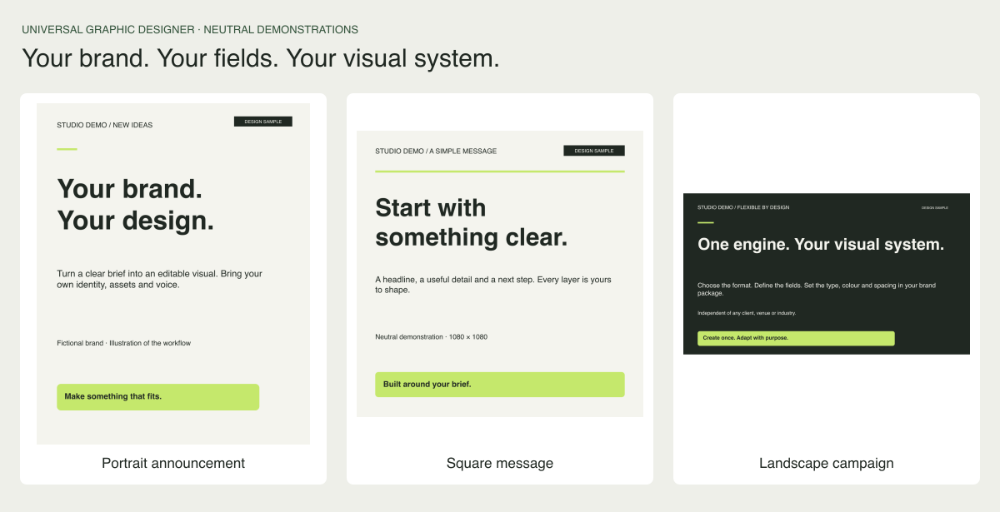

# Graphic Designer

A **brand-independent graphic designer for Nous Research Hermes Agent**. Bring any brand's guide, assets and brief. The bot builds a brand package, chooses an appropriate composition and produces reviewable artwork.



No client identity, sector, palette, logo, language pair or event structure is built into the engine. The included **Studio Demo** is fictional, uses no logo or external assets, and can be replaced completely.

## Download

[Download ZIP](https://github.com/adrianTroop/graphic-designer/archive/refs/heads/main.zip), or:

```bash
git clone https://github.com/adrianTroop/graphic-designer.git
cd graphic-designer
npm ci
npm test
npm run demo
```

Requirements: Node.js 22+ and an installed font that supports the requested languages. The demo uses the system's generic sans-serif. Set `DESIGNER_FONT` to an installed family when an explicit override is needed.

Open a generated job's `review.html`. Three neutral examples are also included under [examples/rendered](examples/rendered/index.html). Job IDs are immutable; use a new revision ID to rerun a brief without overwriting earlier work.

## Add any brand

```bash
node src/cli.cjs init-brand acme --name "Acme"
node src/cli.cjs validate-brand acme
node src/cli.cjs render brands/acme/example-brief.json
```

This creates a working **provisional** package. Replace its neutral colours, typography, layouts and copy with the brand's own rules. Add original logos or photographs when needed; neither is mandatory.

- `brands/acme/design.md`: identity, publication families, references, workflow and gaps.
- `brands/acme/brand.json`: tokens, fonts, template names, arbitrary content fields, canvas sizes and ordered layers.
- `brands/acme/assets/asset-manifest.json`: original/adapted asset paths and provenance.
- `brands/acme/example-brief.json`: a ready-to-render sample input.
- `brands/acme/workspace-design.md`, `image-style.txt` and `workspace-settings.json`: separate sources for workspace Brand guidelines fields.

New local brand folders are ignored by Git by default. Share a client package deliberately when appropriate; the public core does not need client assets to function.

## Export workspace brand guidelines

Generate paste-ready settings for a screen with separate Design guide, Image style, Brand colours and Fonts fields:

```bash
node src/cli.cjs export-workspace studio-demo --id v01
```

This writes **DESIGN.md** (maximum 12,000), **IMAGE_STYLE.txt** (maximum 600), **BRAND_COLOURS.txt** (primary first), **FONTS.txt** (heading and body), a JSON record and paste instructions under `exports/studio-demo/v01/`. Over-limit text fails without truncation. Use your own brand ID and a new revision for each export.

See the [ready-to-copy fictional example](examples/workspace-settings/studio-demo/v01/README.md) and [setup instructions](docs/workspace-brand-settings.md). Pictures and transparent assets remain in the full brand guide and asset library. These text exports do not change workspace settings automatically.

## Use with Hermes

From the repository root:

```bash
hermes skills trust
hermes chat -s brand-designer
```

Example request:

> Create a brand package for my company from the guide and assets I provide. Define a portrait promotion, square announcement and landscape campaign graphic in our own style. Make the content fields fit our business. Render a draft, inspect the result, and deliver editable files and a QA report.

The [basic Hermes file](.hermes.md) supplies the project instructions. The [workflow skill](.hermes/skills/brand-designer/SKILL.md) gives the process. An optional [SOUL.md](profiles/graphic-designer/SOUL.md) supplies a dedicated designer persona. See [Hermes setup](docs/hermes-setup.md).

## What is universal

| In the core | In each brand package |
| --- | --- |
| Brief validation and production workflow | Identity, audience, tone and references |
| Text wrapping, overflow checks and editable SVG composition | Fonts, colours, spacing and visual rules |
| Rectangles, ellipses, lines, text and local asset layers | Templates, layer order and content fields |
| PNG export, provenance and review reports | Logos, photography, iconography and motifs |
| Versioned jobs and reusable onboarding | Sector-specific facts, claims and language variants |

A product launch can use `product`, `price` and `cta`; an editorial cover can use `title`, `deck` and `credit`; a venue can use `date` and `location`. Those fields and template names are defined in JSON, without changing renderer code. There is no fallback to another brand.

## Outputs and limits

Each job includes an editable SVG, PNG, original brief, provenance manifest, mechanical QA report, caption/alt-text drafts and an HTML review page. Vector assets remain vector components; original raster assets remain raster. Drafts carry a visible review label.

The included renderer produces **static compositions**. Hermes can use other available tools for illustration, documents, motion and specialist print work, but this repository does not itself implement video editing, CMYK/prepress certification, scheduling, publishing or analytics. Mechanical checks do not verify factual accuracy, translations, font shaping, rights or brand approval.

## Documentation

- [Universal design standard](design.md)
- [Brand onboarding](docs/brand-onboarding.md)
- [Template contract](docs/template-contract.md)
- [Brief contract](docs/brief-contract.md)
- [Standardisation model](docs/standardisation.md)
- [Workspace brand settings](docs/workspace-brand-settings.md)
- [v2 migration](docs/migration-v2.md)
- [Verification](docs/verification.md)

The current distribution includes only neutral original demo compositions. Third-party assets added by users retain their own ownership and usage terms. Public availability is not a licence for imported brand material.
