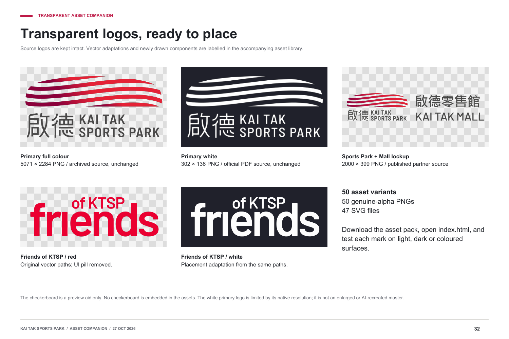
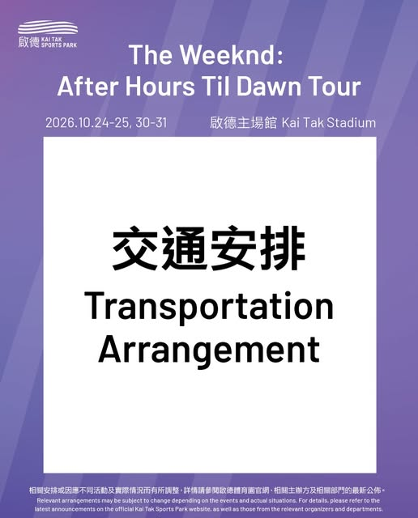
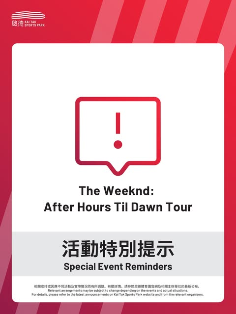
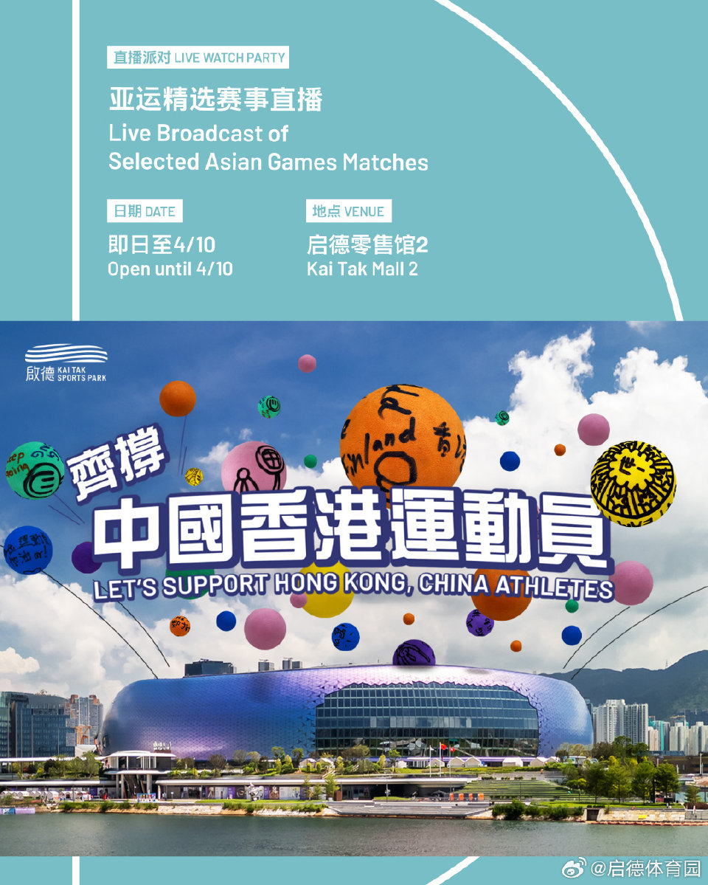
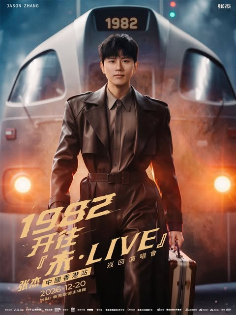
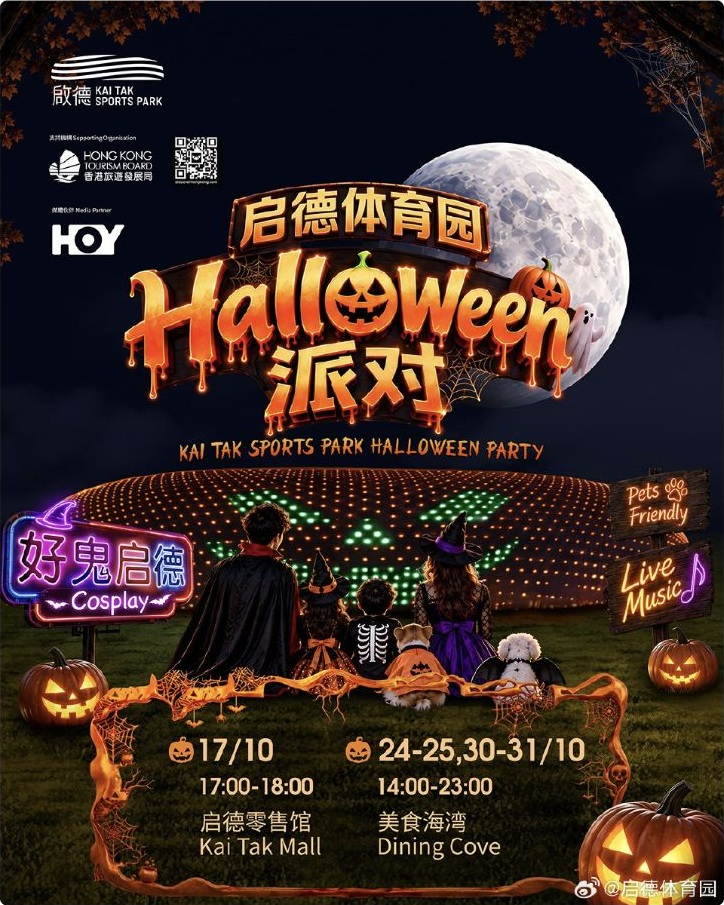
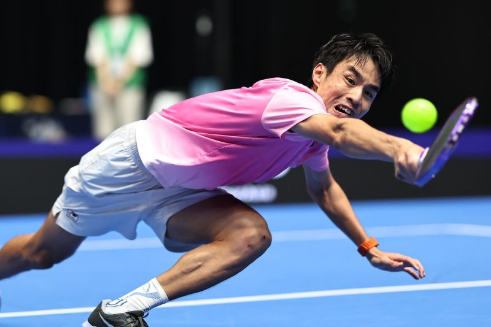
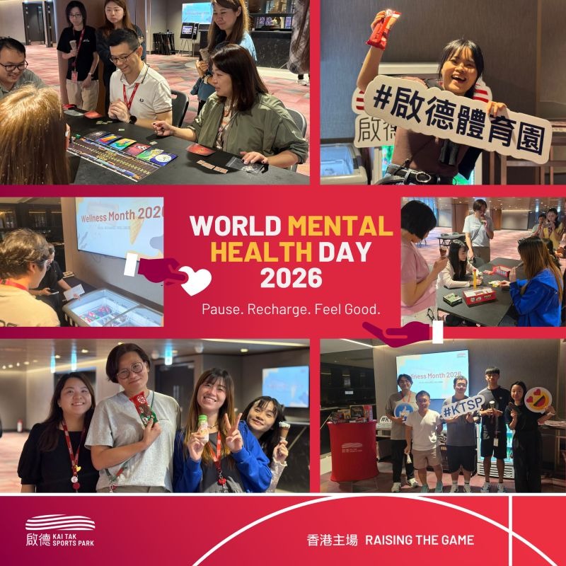

# Kai Tak Sports Park — Social Design System

Version 1.0 · 27 October 2026 · Companion to the audited social visual guide and transparent asset pack.

## 1. Purpose and evidence status

Use this specification to create social publications that match the visual families documented in Kai Tak Sports Park’s accessible public posts. It is a working production system derived from the audit, not KTSP’s official identity manual.

Three evidence labels apply throughout:

| Label | Meaning |
| --- | --- |
| **Observed** | Visible in the inspected publication, image, thumbnail or source asset. |
| **Inferred** | A likely production process suggested by the output; internal practice is unverified. |
| **Proposed** | A practical build rule or reconstruction supplied for future production. |

Asset provenance is separate: **source raster**, **source vector**, **source vector adaptation**, or **redrawn component**. A redraw is not an official master.

### Companion files

- [Audited visual guide, including transparent assets](references/social-visual-guide.pdf)
- [52-record social reference library](references/social-reference-library.html)
- [Transparent asset catalogue](assets/index.html)
- [Per-asset sources, dimensions and status](assets/asset-manifest.json)
- [Asset usage notes](assets/READ_ME_FIRST.txt)

Links are relative to this file so the brand folder remains portable. Keep the accompanying files and folders together.

### Audit coverage

| Channel | Inspected visual sample | Boundary |
| --- | --- | --- |
| Instagram | 12 covers and six Highlight covers | Carousel interiors, full captions and Stories were not inspected. |
| LinkedIn | 10 posts: five photo albums, two videos, two PDF previews, one authored collage | PDF interiors were not inspected. |
| YouTube | 24 landscape thumbnails and one Shorts cover | One video sampled at five timestamps; most playback and audio uninspected. |
| Weibo | Five posts, including 15-image monthly and 10-image reminder packages | All gallery previews inspected; selected full assets inspected. Gallery tiles can crop originals. |
| Facebook | No usable visual post sample | A text preview does not establish a visual pattern. |
| Xiaohongshu | No usable visual post sample | Note titles were briefly accessible; artwork blocked. |
| Douyin | No usable visual post sample | Feed error/login prevented inspection. |

The 52 publication records are a purposeful sample, not a complete archive. Do not infer posting frequency, engagement performance, paid media results or internal staffing from these records.

## 2. Design direction

**Observed:** the account combines practical visitor information, event promotion, community participation and institutional storytelling. Its coherence comes from repeated publication families, bilingual hierarchy and venue identity, while event-specific creative remains varied.

Preserve these principles:

1. Select the publication family from the communication job.
2. Give practical instructions a clear hierarchy and repeatable frame.
3. Keep approved promoter artwork and campaign identities intact.
4. Let venue, people and action photography lead recaps.
5. Treat a cover, an information card and a reference table as different layouts.
6. Keep identity, decoration, content and publication wrappers independently editable.

## 3. Identity assets and transparency



The pack contains **50 variants: 50 transparent PNGs and 47 SVGs**. All PNGs were checked for an alpha channel and transparent pixels. All SVGs contain vector elements without embedded raster images. Checkerboards in previews are not part of the asset files.

### Logo inventory

Paths below are relative to `assets/01_Logos/`.

| Asset | File | Native size / status | Placement rule |
| --- | --- | --- | --- |
| Primary colour | `ktsp-primary-colour-5071.png` | 5071 × 2284; unchanged archived raster attributed to KTSP | Preserve proportions; use on a sufficiently light surface. |
| Primary white | `ktsp-primary-white-native-302.png` | 302 × 136; unchanged raster extracted from the official venue capacity PDF | Small placements only. Suggested maximum 151px displayed at 2× density or 25.6mm at 300ppi. |
| Sports Park + Mall | `ktsp-kai-tak-mall-lockup-colour.png` | 2000 × 399; unchanged partner-published raster | Preserve the combined arrangement. It is not a standalone Mall wordmark. |
| Friends of KTSP, red | `friends-of-ktsp-red.svg` and `.png` | Source vector lettering; UI pill removed; PNG 1120 × 400 | Membership contexts; retain lettering geometry. |
| Friends of KTSP, white | `friends-of-ktsp-white.svg` and `.png` | White adaptation of the same paths; PNG 1120 × 400 | Dark surfaces; this variant is not independently confirmed as brand-approved. |

Do not stretch, trace, retype, invent a vector master, rearrange the bilingual lockup or add effects to a logo. Formal clear-space and minimum-size rules were not recovered. Maintain visibly generous separation and obtain the official measurements before claiming brand compliance.

Transparency permits placement over different surfaces; it does not guarantee contrast. Inspect white edges on dark and coloured backgrounds and colour marks on light backgrounds. Do not upscale the 302px white logo for large artwork; obtain a higher-resolution or vector master.

### Other asset categories

| Folder | Contents | Status |
| --- | --- | --- |
| `02_Social_Platform_Marks/` | Facebook, Instagram, LinkedIn, YouTube, Xiaohongshu, Douyin and Weibo; SVG + 512px PNG | Website-supplied paths. Facebook backplates were removed; other artwork retained. These are platform identities, not KTSP-owned marks. |
| `03_Service_Icons/` | 14 symbols, each red-gradient and white; SVG + 1024px PNG | Newly drawn components matching the observed outline family. |
| `04_Graphic_Overlays/` | Court lines, court arc, diagonal strips and open-centre frames | Working vector reconstructions, with transparent PNG exports. |
| `05_Layout_Components/` | Rounded white panel, square white panel and grey topic band | Separate shapes on transparent canvases. |

An intentional solid tile within a social icon or a white information panel is part of that component. Do not remove it merely because the surrounding canvas is transparent.

## 4. Colour system

### Observed reference samples

These are single-pixel samples from inspected raster references. Gradients, compression and display rendering affect the result. They are **not official brand colour specifications**, and no Pantone or CMYK equivalents are asserted.

| Reference | Approximate sample | Role |
| --- | --- | --- |
| IG03 | `#CB0F41` | Monthly cover red field |
| IG01 | `#8170B4` | Purple event-guide field |
| WB02 event card | `#78BEC6` | Teal information area |
| WB02 event card | `#8C934F` | Olive information area |

Monthly inside pages also show yellow, orange, coral and lilac/purple. Select the treatment from the relevant reference instead of treating all sampled colours as a universal corporate palette.

### Working component tokens

These values describe the supplied reconstructed assets. They are **proposed implementation values** unless explicitly marked as source artwork.

| Token | Value | Use |
| --- | --- | --- |
| `guide-purple` | `#8170B4` | Supplied purple frame |
| `operational-gradient-start` | `#8F1649` | Red operational frame gradient |
| `operational-gradient-end` | `#EE163F` | Red operational frame gradient |
| `court-line-red` | `#BD1946` | Red court-line overlay |
| `icon-gradient-start` | `#8F1D54` | Red service-icon gradient |
| `icon-gradient-end` | `#DB3146` | Red service-icon gradient |
| `strip-burgundy` | `#8F1748` at 55% | Separate burgundy diagonal overlay |
| `strip-light` | `#FFFFFF` at 18% | Separate light diagonal overlay |
| `panel-white` | `#FFFFFF` | Information panels and white marks |
| `topic-grey` | `#E8E8E8` | Supplied topic/date band |
| `friends-red` | `#EC0032` | Retained source lettering colour; not a universal feed colour |

Use the actual SVG gradient and opacity settings when reproducing the supplied components. Do not substitute one flat red for every family. Colours used to style the audit document itself do not establish KTSP brand tokens.

## 5. Typography and language

Exact official font files were not recovered. Do not describe a substitute typeface as KTSP’s actual font.

| Family | Observed hierarchy | Production instruction |
| --- | --- | --- |
| Practical guides and reminders | Heavy sans-serif Chinese; smaller sans-serif English; compact facts and footer | Keep Chinese headline, English support, facts and notice in separate text layers. |
| Monthly programme | Large month heading; structured category, title, date and venue | Maintain consistent field order across event cards. |
| Documentary thumbnails | Expressive Chinese lettering with italic English in archive examples | Use a distinct series treatment; seek original series assets. |
| Promoter/campaign artwork | Typography follows the event identity | Retain approved artwork; do not replace its lettering with house fonts. |

**Proposed:** use an approved CJK-capable sans-serif substitute for editable working layouts until original fonts are supplied. Store the chosen font family, weight and licence with the project. Judge hierarchy and the smallest text at the actual phone-sized preview; exact point sizes and official tracking values are not established by the audit.

Observed localisation patterns:

- Instagram practical artwork often leads with Traditional Chinese and supports it with English. Caption rules are unverified.
- LinkedIn captions are English-led and emphasize people, outcomes, partners and credits.
- Weibo captions use Simplified Chinese, structured event fields, emojis and hashtags. Simplified Chinese also appears in inspected artwork.
- Many YouTube titles and covers are bilingual; the series determines the treatment.

Maintain separate TC, SC and EN fields. Check proper names, dates, locations and ticket information across variants. Do not treat translation as a graphic placed over the original text.

## 6. Photography, icons and graphic motifs

### Photography

**Observed:** corporate albums document action, venue scale, speakers, audience, groups and participation. Use original photography with clear subjects and deliberate crops. The platform’s native album mosaic is not an authored brand template.

**Proposed:** retain the uncropped original, crop position, credit and usage status. Avoid placing critical text over faces, action or busy detail. Do not retouch an event photograph into a claim about attendance, results or facilities that it does not support.

### Service icons

The 14 supplied symbols are `alert`, `water`, `bottle-restriction`, `food-restriction`, `umbrella`, `accessibility`, `security-wand`, `locker`, `how-to-go`, `offers`, `information`, `events`, `shop-dine` and `tickets`.

Filename pattern: `03_Service_Icons/icon-{symbol}-{red|white}.{svg|png}`.

Keep a consistent outline treatment and use one clear symbol per subject. Operational wording and restriction measurements remain separate. The supplied water icon is red/white, while an observed water card uses blue; the pack is not an exhaustive reproduction of every colour variant.

### Motif families

| Motif | Intended family | Separation rule |
| --- | --- | --- |
| Diagonal strips | Practical guides and operational reminders | Keep colour field, strips, frame and information panel distinct. |
| Fine court arcs and lines | Monthly programme and selected corporate editorial pieces | Keep lines separate from photography, text and logo. |
| Campaign illustration/texture | Seasonal or promoter creative | Preserve that campaign’s own art direction. |

Do not apply diagonal strips and court graphics indiscriminately to every post.

## 7. Publication families and visual references

The images below are captured publication references, not editable production assets. Open the linked source or the reference library for evidence depth and additional images.

### A. Purple event guide



**Observed:** two related covers repeat a purple diagonal-strip field, small white logo at upper left, centered event information, a square white inner panel, Chinese task heading, smaller English and a footer outside the panel. Evidence: [IG01](https://www.instagram.com/kaitaksportsparkhk/p/De4MlHJgX8n/) and [IG02](https://www.instagram.com/kaitaksportsparkhk/p/De1bBITAUJB/).

**Build:** keep the event header, date and venue stable while changing the practical subject. Use `guide-frame-4x5-purple` with `panel-square-white-4x5`. Purple is supported for this paired event treatment; it is not proven as the colour for every guide. Interior carousel layouts remain unverified.

### B. Red operational publication



**Observed:** red/pink/burgundy diagonal framing, rounded white panel, Chinese-led information, optional central line icon, grey topic/date bands and a compact notice. Evidence: [IG09](https://www.instagram.com/kaitaksportsparkhk/p/De1JS0nAUVg/) and [WB03](https://weibo.com/2/detail/5342032467331463).

**Build:** separate cover, single-rule, restriction-list, transport/date and map variants. Use `operational-frame-3x4-red` with `panel-rounded-white-3x4`. The inspected WXV package has ten images: cover → containers → food/drink → umbrellas → water → accessibility → three restriction pages → locker map. That sequence is one observed package, not a fixed requirement for every event.

### C. Monthly programme



**Observed:** red month cover with white logo and fine court lines; inside event cards combine a coloured information area with event artwork. Image and information placement can flip. The inspected October set has one cover, twelve event cards and two summary calendars. Evidence: [IG03](https://www.instagram.com/kaitaksportsparkhk/p/Dd6GNKlgUDM/) and [WB02](https://weibo.com/2/detail/5348918372337606).

**Build:** maintain three components—month cover, event-card variants and summary table. Required card fields: category, bilingual event title, date, venue and approved event visual. Adapt the number of cards to the verified programme; do not hard-code 15 images.

### D. Promoter and partner artwork



**Observed:** event-specific typography, illustration, photography, palette and sponsor arrangements. Evidence: [IG05](https://www.instagram.com/kaitaksportsparkhk/p/De_B4opgWkx/) and [WB05](https://weibo.com/2/detail/5338658981019689).

**Build:** request approved image/crop variants and preserve the identity. Keep ticket and venue facts traceable. Use a separate practical-service publication where needed. A ticket package may include a cover, seat map, benefits and presale information; it need not use the operational frame.

### E. Editorial and seasonal campaign



**Observed:** the Concert Super Guide uses orange texture, condensed black Chinese lettering and stadium imagery; Halloween uses a dark scene, orange dimensional lettering, neon accents and a partner area. Evidence: [IG07](https://www.instagram.com/kaitaksportsparkhk/p/De25vccAYhP/) and [WB01](https://weibo.com/2/detail/5350959955577765).

**Build:** preserve each campaign’s art direction and establish its own asset set. These individual examples demonstrate variety, not a permanent seasonal palette or recurring frequency.

### F. Corporate photo album



**Observed:** native albums use real photography and outcome-led captions. Evidence: [LI02](https://www.linkedin.com/posts/kai-tak-sports-park_kaitaksportspark-ktsp-kaitakarena-activity-7520394295439228929--IHB).

**Build:** choose a strong lead photo, then sequence action, context and people. Deliver individual photos rather than a screenshot of the platform mosaic. Maintain credits and factual caption support.

### G. Branded collage and PDF document



**Observed:** an authored collage uses red gutters, a message tile, red footer, white logo and court lines. Related PDF previews combine branded headings and photography. Evidence: [LI07](https://www.linkedin.com/posts/kai-tak-sports-park_kaitaksportspark-ktsp-ktspeople-activity-7514641156429762560-e-YZ) and [LI10](https://www.linkedin.com/posts/kai-tak-sports-park_kai-tak-sports-park-unites-the-city-in-support-activity-7512829335423053825-_uVo).

**Build:** keep photo slots, message tile, gutters and footer editable. A collage is one authored image; a document is a multipage PDF. LI10 displayed eight pages, but interiors and page dimensions were not verified. Do not invent a standard slide sequence from its cover.

### H. Event video and documentary series


**Observed:** many event thumbnails use venue/people photography, a small white logo and compact bilingual titles, sometimes a lower strip with a slim red accent. Documentary thumbnails use a separate expressive type treatment. Evidence: [YT01](https://www.youtube.com/watch?v=Rj3PqpFS2_4) and [YT19](https://www.youtube.com/watch?v=30fZSQDUWdA).

**Build:** maintain distinct thumbnail families. The thumbnail, video graphics and feed preview are separate deliverables. Keep subtitles editable; do not infer an entire motion system from a thumbnail. One inspected Shorts cover is insufficient evidence for a recurring Shorts template.

## 8. Publication formats and delivery

The canvases below are **proposed production sizes**, not recovered export presets or statements of platform upload limits. Verify the actual placement before scheduling.

| Publication | Observed evidence | Proposed build / delivery |
| --- | --- | --- |
| Portrait still, 4:5 | IG examples and WB01 at 960 × 1200 | 1080 × 1350; PNG for graphic artwork or high-quality JPEG for photographs. |
| Portrait still, 3:4 | IG examples and WB03 source dimensions of 960 × 1280 | 1080 × 1440; preserve approved source proportions. |
| Carousel / image set | IG cover badges; WB02 4:5 and WB03 3:4 packages | One canvas within a package; distinct cover, body and reference-page layouts; numbered exports. |
| Native photo album | Five inspected LinkedIn posts | Individual original photos plus intentional lead-image crops. |
| Designed collage | LI07 | One image exported from an editable grid; final dimensions chosen for the placement. |
| PDF document | LI01 and LI10 previews | Set trim size before design; consistent page dimensions; review every exported page. |
| Highlight cover | Six circular covers inspected | Square source canvas with centered icon; test circular crop. A 1080 × 1080 working master is proposed. |
| Landscape video | YouTube; LI09 poster at 1280 × 720 | 1920 × 1080 working master, separate thumbnail, caption track and delivery MP4. |
| Vertical video | LI04 poster at 640 × 1138; portrait WB04 preview | Dedicated 1080 × 1920 working edit; reframe subject and captions. |
| Video thumbnail | Landscape YouTube references | Separate 16:9 composition; 1920 × 1080 working file proposed. |
| Shorts preview | One served cover at 405 × 608 | Preview crop does not establish video ratio. Test the video and cover separately. |

Runtime varies in the inspected sample. No fixed 15/30/60-second rule is supported. Exact codecs, official colour profiles and universal pixel-safe zones were not recovered. Preview critical text, faces and CTAs under the target platform UI.

## 9. Component geometry and editable layers

### Supplied reconstruction geometry

These measurements describe this handoff’s SVGs, not official KTSP templates. All coordinates are in the component canvas. Scale proportionally and review text fit; do not stretch a 4:5 frame into 3:4.

| Component | Canvas | Geometry |
| --- | --- | --- |
| Red operational frame / matching panel | 1080 × 1440 | Opening/panel: x 65, y 155, width 950, height 1190, corner radius 28. |
| Purple guide frame / matching panel | 1080 × 1350 | Opening/panel: x 112, y 365, width 856, height 800; square corners. |
| Grey topic band | 1080 × 216 | Shape: x 60, y 28, width 960, height 160. |
| Court-line overlay | 1080 × 1350 | Fine 5-unit strokes; preserve the SVG paths. |
| Event-card arc | 1080 × 1350 | Fine 6-unit strokes; preserve the SVG paths. |

Frames have transparent openings. Their white panels are separate files. Text, logo, photo and footer are not baked into those components.

### Proposed layer tree

```text
Publication
├── 00_Metadata [non-exporting: event ID, sources, language, version]
├── 01_Background [colour field or photograph]
├── 02_Motif [court lines OR diagonal treatment OR campaign graphic]
├── 03_Frame [family-specific, if needed]
├── 04_InformationPanel [optional; independent from frame]
├── 05_Identity [venue, campaign and partner lockups in separate groups]
├── 06_ContentVisual [photo, promoter art, icon, map or table]
├── 07_Headline_TC_or_SC
├── 08_EnglishSupport
├── 09_EventFacts [date, time, venue, ticket details]
├── 10_CTA
└── 11_NoticeAndCredits
```

Adjust stacking for the chosen family without flattening the working master. A map, restriction list and summary table each require their own editable structure. Preserve linked source artwork and its original crop outside the export artboard.

### Proposed content record

```yaml
event_id: ""
family: "operational | guide | monthly | promoter | seasonal | album | collage | document | video"
publication_role: "cover | body | rule | map | summary | thumbnail"
channel: ""
language: "TC | SC | EN | bilingual"
canvas_px: [1080, 1350]
title_primary: ""
title_english: ""
event_date: ""
event_time_and_timezone: ""
venue: ""
ticket_or_action_url: ""
notice: ""
asset_sources: []
asset_status: "source | adapted | redrawn"
fact_owner: ""
version: "v01"
review_status: "draft"
published_url: ""
```

Naming example: `KTSP_EventID_ServiceReminder_TC_3x4_01_v03.png`. Keep editable master, image sequence, captions, alt text and source record together. Do not use an old export as the source of truth for a changed event fact.

## 10. Workflow

### What the output suggests

| Workstream | Evidence | Inferred workflow |
| --- | --- | --- |
| Event service | Several transport, security and guide posts for one event | A shared facts source feeds specialized publications close to the event. Exact lead times and ownership are unknown. |
| Monthly programme | Related Instagram cover and 15-image Weibo set | Compile events, collect visuals, assemble cards and reconcile dates/venues. |
| Promoter promotion | Distinct event art and ticket information packs | Receive approved assets and event facts, then adapt placement and language. |
| Corporate recap | Albums, collage, documents and outcome-led captions | Select photographs, verify results and credit partners. |
| Video adaptation | Shared story appears on YouTube and LinkedIn | Prepare channel-specific titles and covers. Identical files or automated cross-posting are unverified. |

### Recommended operating sequence

1. **Brief:** record the audience, event, communication job and authoritative event facts.
2. **Choose:** select publication family, format and required language variants.
3. **Assemble:** use separated identity, motif, text, image, icon and footer components.
4. **Verify:** check operational facts with the relevant owner; reconcile language variants and credits.
5. **Preview:** inspect every slide, crop, PDF page, thumbnail and subtitle placement at final viewing size.
6. **Publish and maintain:** check live rendering and links; save the final URL and version. Recheck all linked variants when facts change.

These roles and steps are proposed. KTSP’s internal software, team structure, approval chain and production time were not established by public posts.

## 11. Acceptance checklist

- [ ] Publication family and format are identified.
- [ ] Event name, date, time, timezone, venue and action URL match the current facts source.
- [ ] Language variants carry consistent facts and correctly localized names.
- [ ] Official source marks, adapted vectors and redraws are labelled accurately.
- [ ] Logo proportions and partner arrangements are intact; raster resolution suits placement.
- [ ] All supplied assets are inserted as files, not copied from checkerboard screenshots.
- [ ] Transparent PNGs display correctly on light, dark and coloured backgrounds.
- [ ] Frame, panel, motif, logo, text and functional visuals remain separate in the master.
- [ ] The smallest text is readable at the intended viewing size.
- [ ] Every carousel image, PDF page and preview crop has been checked.
- [ ] Video cover, captions and subject remain visible under platform UI.
- [ ] Credits, alt text, final export names, version and source links are retained.

## 12. Known gaps and revision policy

Still needed for a complete official production library: high-resolution/vector primary white logo; dedicated Stadium, Arena and Youth Sports Ground marks; standalone Mall wordmark; official fonts; approved colour/clear-space rules; original motif masters; and third-party event/sponsor artwork.

Access gaps remain for Facebook visual posts, Xiaohongshu artwork, Douyin posts, Instagram interiors/captions/Stories, LinkedIn PDF interiors and most video playback. Do not fill these gaps by extrapolating from another channel.

When new official masters or accessible publications become available, record the source and date, replace provisional components deliberately, and update this file, the asset manifest and affected templates together. Preserve the distinction between historical audit evidence and new production decisions.
